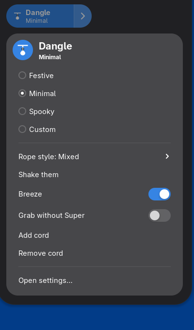
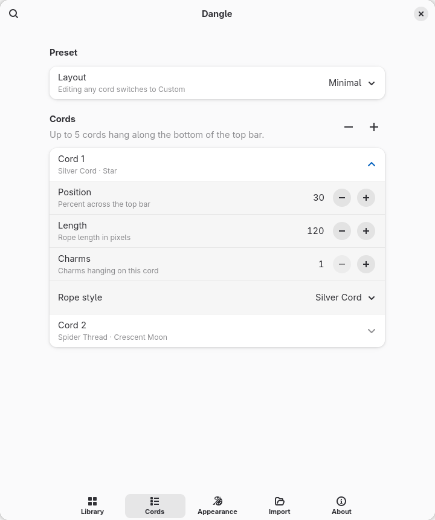
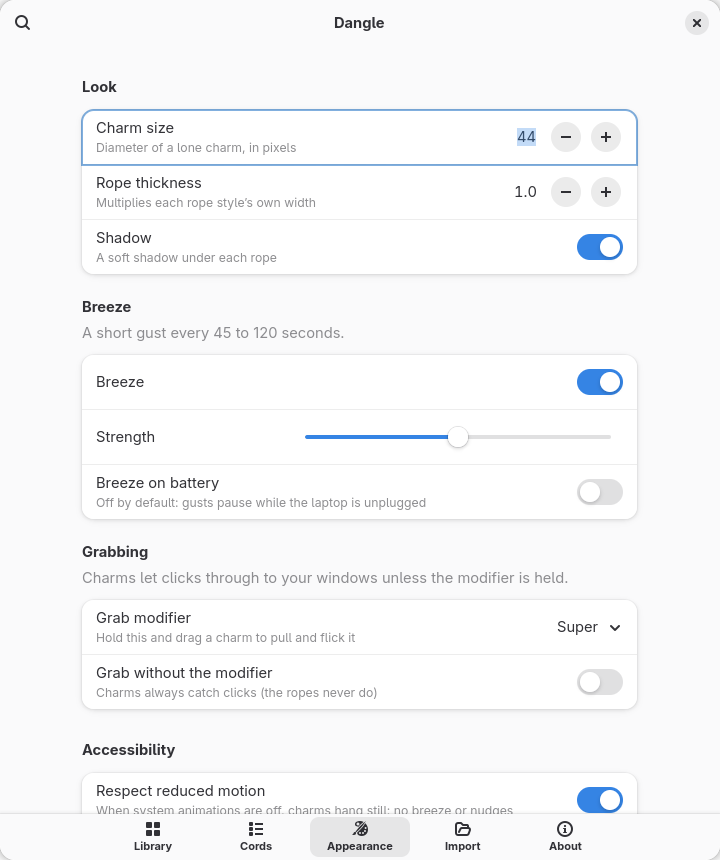

# Dangle

Little physics-simulated charms hanging on ropes from the bottom of the GNOME
top bar. They sway in an occasional breeze, get nudged when your pointer brushes
past, and can be grabbed and flicked while you hold <kbd>Super</kbd>. Everything
is controlled from Quick Settings.

- GNOME Shell 50, Wayland · UUID `dangle@nithees`
- 0% CPU when still: animation stops completely once every charm settles
- Clicks always reach your windows: charms only catch clicks while the grab
  modifier is held, and the ropes never do

## Screenshots

| Festive | Spooky | Minimal (default) |
|---|---|---|
|  |  |  |

The nine rope styles — Thread, Leather, Gold Chain, Silver Chain, Neon, Spider
Thread, Midnight Cord, Temple Thread, Silver Cord:


| Quick Settings | Library | Cords | Appearance | Import |
|---|---|---|---|---|
|  |  |  |  |  |

## Using it

- **Quick Settings** (the Wi-Fi/volume/battery menu): the **Dangle** toggle shows
  or hides every charm. Its arrow opens the menu: presets (Festive, Minimal,
  Spooky, Custom), rope style, *Shake them*, Breeze, *Grab without Super*,
  Add/Remove cord and *Open settings…*
- **Grab and flick**: hold <kbd>Super</kbd>, press on a charm, pull and let go.
  The modifier can be Alt or Ctrl+Alt instead (Settings → Appearance).
- **Hover**: brushing the pointer past a charm nudges it.
- **Breeze**: a gentle gust every 45–120 seconds; it pauses on battery unless
  *Breeze on battery* is on, and stops entirely when system animations are off.
- **Settings**: Library (hang any charm on any cord, drag to reorder), Cords
  (position, length, charms, rope style), Appearance, Import (your own PNG, JPG
  or SVG pictures) and About.

Charms hide in the Activities overview, while a window is fullscreen on the
primary monitor, and on the lock screen.

## Install (fish)

```fish
make install          # copies core/, compiles schemas, installs to ~/.local/share/gnome-shell/extensions/
```

Wayland cannot load a newly installed extension into the running session. Log
out and back in, then:

```fish
gnome-extensions enable dangle@nithees
```

To remove it completely: `make uninstall`.

## Try it in a nested shell first

```fish
sudo pacman -S mutter-devkit     # once
make install
make nested                      # a GNOME Shell 50 session in a window
```

In the nested session open Console and run `gnome-extensions enable dangle@nithees`.
Its log appears in the terminal you ran `make nested` from. For per-frame timing
(physics and actor updates, logged each time the animation stops):

```fish
env DANGLE_DEBUG=1 make nested
```

`tools/cycle.fish`, run inside the nested session, disables and enables Dangle
20 times; the nested terminal should show no errors.

## Development

| Command | What it does |
|---|---|
| `make test` | `node --test tests/`: rope physics, styles, charm layout, wind, cords, presets, artwork, and a 5 cords × 3 charms bench (≤ 1 ms/frame) |
| `make lint` | ESLint with GNOME Shell's style rules |
| `make headless-test` | Runs Dangle inside a throwaway headless GNOME Shell 50 (isolated settings) and checks it for real: stacking, click-through with real windows, Super+click grab, Quick Settings, the preferences window, import, fullscreen, two monitors, idle cost, 20 enable/disable cycles |
| `make pack` | `dist/dangle@nithees.shell-extension.zip` for extensions.gnome.org |
| `make logs` | Follow GNOME Shell's journal |

Layout: `core/` is pure JavaScript shared by node and the Shell (copied into
`extension/core/` by `make sync`); `extension/` is the extension itself;
`tools/` holds the headless test driver.

### How it stays cheap

- The rope is a 20-link Verlet chain stepped at a fixed 240 Hz with a capped
  solver; ropes are drawn as thin GPU-transformed widgets, so a moving rope never
  repaints anything on the CPU.
- A single `Clutter.Timeline` drives every cord and stops as soon as all of them
  are still; the pointer is polled at 4 Hz (20 Hz only near the cords), and not
  at all while the charms are hidden.
- Measured in GNOME Shell: ~1.5 ms per frame with five cords of three charms all
  swinging; zero repaints once they settle, and idle CPU within measurement noise of
  having Dangle disabled.

## License

GPL-2.0-or-later (see `LICENSE`). The rope solver ports ideas and numeric values
from an MIT-licensed project; see `NOTICE.md`. All charms and icons are original.
